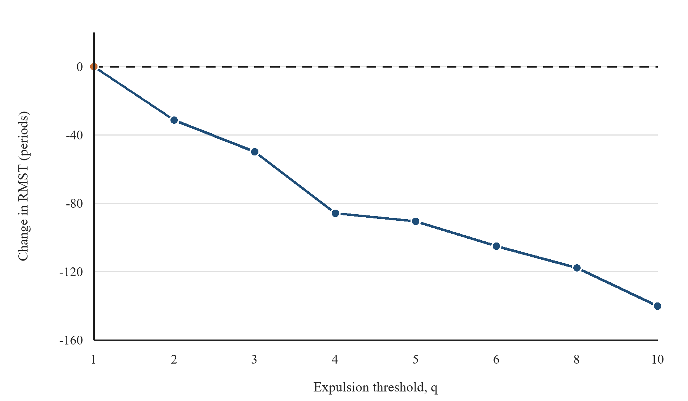

# E. Expulsion Threshold Response Surface

This repository contains the reproducibility package for the group E section on
how strict expulsion should be. The analysis varies the public-report threshold
`q = 1, 2, 3, 4, 5, 6, 8, 10` while holding market size, trading constraints,
conversion threshold, horizon and the bankruptcy rule fixed.

The reported analysis covers 4,000 simulated markets. Of these, 2,413 collapse
inside the 200-period window, a pooled collapse rate of 60.3%. Relative to
`q = 1`, the survival coefficients are `-31.4, -49.9, -85.9, -90.5, -105.1,
-117.9, -140.3` periods for `q = 2` through `q = 10`.



## Repository structure

```text
.
├── threshold_analysis.py
├── build_report_docx.py
├── requirements.txt
├── figures/
│   ├── figure_e1_survival_response.png
│   └── figure_e1_survival_response.svg
├── report/
│   ├── report.md
│   └── report.docx
└── tables/
    ├── table_e1_threshold_response.csv
    ├── table_e1_threshold_response.md
    ├── table_e1_market_rmst_template.csv
    ├── design_parameters.csv
    └── sample_accounting.csv
```

## Rebuild the report and figures

Install the dependencies and run the two scripts from the repository root:

```bash
python -m pip install -r requirements.txt
python threshold_analysis.py
python build_report_docx.py
```

The first command regenerates the figure and summary tables. The second reads
`report/report.md` and rebuilds `report/report.docx` with the same text, table
and figure order.

## Analyze the complete run-level file

When the full simulator output is available, pass it with `--input`:

```bash
python threshold_analysis.py --input /path/to/threshold_runs.csv
```

The run-level file must contain:

| Column | Meaning |
| --- | --- |
| `q` | Expulsion threshold |
| `rho` | Initial cheater share |
| `seed` | Random seed |
| `surv` | Restricted survival time |
| `collapsed` | 1 if the market collapsed, 0 otherwise |
| `welfare` | Optional welfare outcome |

This mode fills the five market-specific RMST cells, estimates threshold fixed
effects with seed-clustered standard errors, computes Romano-Wolf step-down
p-values and records bootstrap best-threshold frequencies.

## Data scope

The repository includes the reported aggregate coefficients and the two welfare
endpoints. It does not create the missing intermediate welfare values or the
market-specific RMST cells. The template preserves the required `q x rho`
schema until the complete run-level file is supplied.
