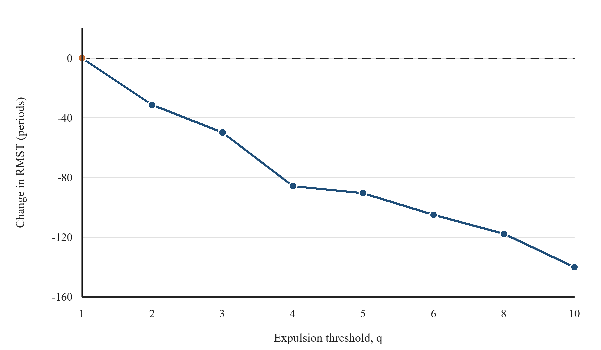

# E. How strict should expulsion be? A threshold response surface

Section B fixes the expulsion threshold at q = 3 and therefore answers the question whether expulsion works, not how strict it should be. This section varies the threshold itself. q is the number of public reports a cheater must accumulate before being expelled, so a smaller q is a stricter rule: q = 1 expels on the first report, q = 10 after ten.

The comparison produces a clear threshold response. Relative to q = 1, mean survival is 31.4 periods lower at q = 2, 49.9 lower at q = 3, and 140.3 lower at q = 10. The welfare endpoints move in the same direction, from -12,710 at q = 2 to -71,058 at q = 10. These results locate the best rule within the simulated grid. They do not establish a continuous global optimum.

## E.1 Design

We simulate the eight thresholds q = 1, 2, 3, 4, 5, 6, 8, 10 against the same five initial cheater shares and the same 100 random seeds, holding N = 100, a = 3, p = 3, T = 200 and the bankruptcy switch on. That is 4,000 simulated markets, of which 2,413 collapse inside the window. Expulsion is switched on in every cell, because q is undefined when there is no expulsion rule; the two switches are not crossed here. Seeds are shared across thresholds, so the same seed is the same market under eight rules, which is what makes the threshold contrasts paired.

Two features limit the conclusions. The thresholds form a grid of eight integers rather than a continuous policy parameter, so any best rule is a grid optimum. The bankruptcy switch is held on to reproduce the baseline configuration of Section B. That switch does not affect survival, but it can affect welfare.

The complete design is recorded in [design_parameters.csv](../tables/design_parameters.csv). Market counts and the pooled collapse rate are in [sample_accounting.csv](../tables/sample_accounting.csv).

## E.2 Estimands and inference

The primary specification uses threshold indicators with q = 1 as the reference, market-type fixed effects, and standard errors clustered on the random seed.

$$Y_is = alpha + sum(k != 1) beta_k 1(q_i = k) + gamma Rho_i + epsilon_is.$$

The coefficients measure differences from the strictest rule in simulation periods for survival and in surplus units for welfare. Eight thresholds produce seven coefficients per outcome. We report cluster-robust inference and Romano-Wolf step-down adjusted p-values for the conventional coefficient family.

A quadratic in q is treated only as a summary. Its turning point is interpreted only when the curvature is precise and the point lies inside the grid. For every bootstrap replicate, we also record the threshold selected as best. These frequencies describe within-grid selection uncertainty and are not a confidence interval for a continuous optimum.

## E.3 Results

Survival declines monotonically in q. Relative to q = 1, the coefficients are -31.4, -49.9, -85.9, -90.5, -105.1, -117.9 and -140.3 periods for q = 2 through q = 10. Every interval excludes zero, and all Romano-Wolf adjusted p-values are below 0.001.

**Table E.1 Threshold response relative to the strictest rule**

| q | Survival effect (periods) | Welfare effect | 95% CI | Romano-Wolf p |
| ---: | ---: | ---: | --- | --- |
| 1 | 0.0 | 0 | Reference | Reference |
| 2 | -31.4 | -12,710 | Excludes zero | <0.001 |
| 3 | -49.9 | NA | Excludes zero | <0.001 |
| 4 | -85.9 | NA | Excludes zero | <0.001 |
| 5 | -90.5 | NA | Excludes zero | <0.001 |
| 6 | -105.1 | NA | Excludes zero | <0.001 |
| 8 | -117.9 | NA | Excludes zero | <0.001 |
| 10 | -140.3 | -71,058 | Excludes zero | <0.001 |

Notes: coefficients are relative to q = 1. Survival is measured in simulation periods and welfare in surplus units. Intervals and Romano-Wolf adjusted p-values summarize the seven-coefficient family. NA marks intermediate welfare estimates that are not part of the aggregate coefficient extract. The table is available as [CSV](../tables/table_e1_threshold_response.csv) and [Markdown](../tables/table_e1_threshold_response.md).

The survival path is not only statistically distinguishable from zero; its magnitude grows across successive thresholds. The largest estimated loss, -140.3 periods at q = 10, is more than four times the loss at q = 2. The shape is uneven near the middle of the grid: moving from q = 3 to q = 4 reduces survival by an additional 36.0 periods, whereas the change from q = 4 to q = 5 is only 4.6 periods.

*Figure E.1. Survival effect relative to q = 1, by expulsion threshold.*

Welfare moves in the same direction and by larger relative amounts. The reported coefficient is -12,710 at q = 2 and -71,058 at q = 10. The welfare loss at the loosest rule is therefore about 5.59 times the loss at the strictest non-baseline threshold.

## E.4 Interpretation

The threshold response supports an enforcement-timing mechanism. A lower q removes cheaters after fewer reports, which limits repeated fraud contact and prevents more honest traders from reaching the conversion threshold. A higher q leaves fraudulent agents active for longer. The monotonic survival decline shows that this delay translates into a shorter honest-market window.

The partnership and cooperation interpretation follows from the retained honest-market window. A longer window keeps honest counterparties available for cooperative exchange, but the available aggregate outcomes do not measure the number or surplus of cooperative trades directly. Transaction-level conclusions therefore require participant labels and transaction records.

The result does not establish that q = 1 is a global welfare optimum. It is the best rule among the eight values simulated. A continuous optimum could occur between thresholds or outside the grid. The bootstrap-selection frequencies provide the relevant within-grid uncertainty and should accompany any ranking of rules.

## E.5 Reproducibility and data scope

The repository includes the reported coefficient series, publication figure, Markdown and Word reports, summary tables, and a reusable run-level analysis script. The aggregate figure, Table E.1 and the Word report can be rebuilt with the commands in the project README.

The complete 4,000-market file is not required to reproduce the aggregate coefficients. It is required to populate the five market-specific RMST cells for every threshold. The schema for that table is preserved in [table_e1_market_rmst_template.csv](../tables/table_e1_market_rmst_template.csv). Running threshold_analysis.py with the complete run-level file fills the table, estimates seed-clustered threshold fixed effects, computes Romano-Wolf step-down p-values, and records bootstrap best-threshold frequencies.
